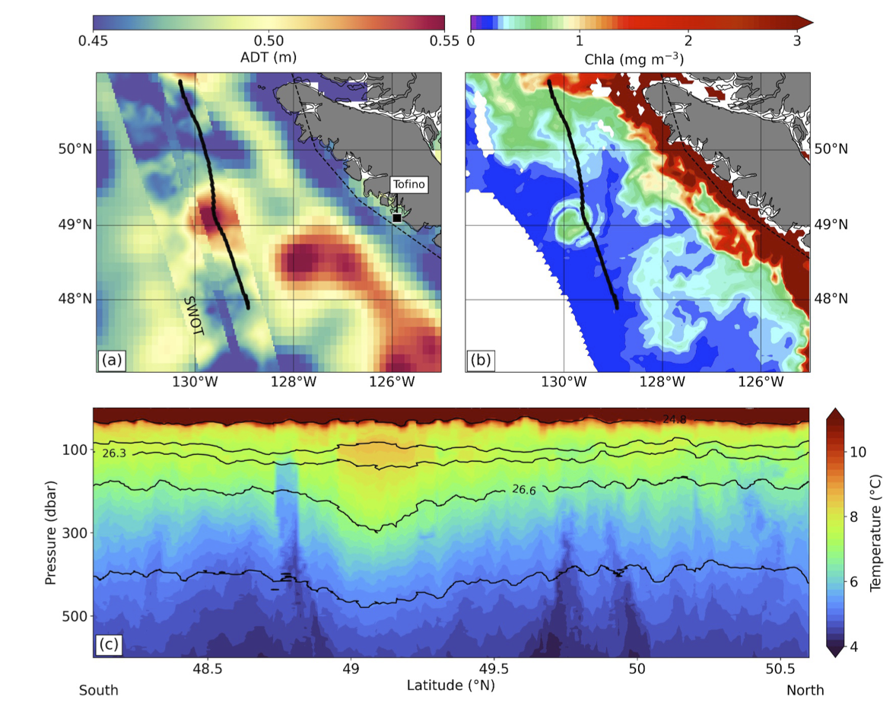

<!-- Start Writing Below in Markdown -->

Congratulations Giuliana Berden on the publication of "From Surface to Depth: SWOT Altimetry and Glider Observations of a Cuddy in the Northeast Pacific" in *Journal of Geophysical Research: Oceans* [10.1029/2026JC024308](https://doi.org/10.1029/2026JC024308).  Funded by the Canadian Space Agency, Giuliana showed how combining SWOT altimetry, older generation altimetry, ocean colour data and glider observations can provide a comprehensive view of a Cuddy in the Northeast Pacific.

