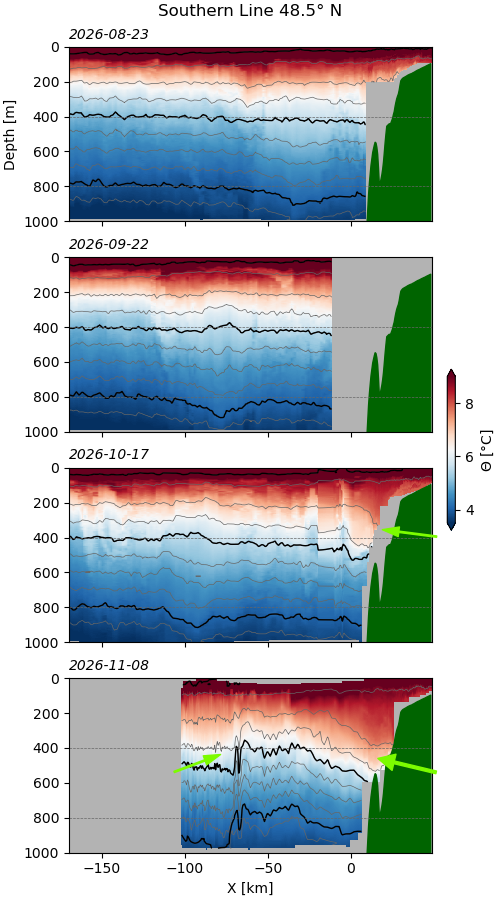
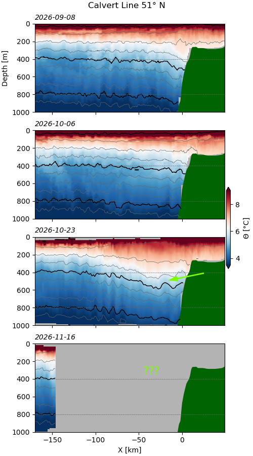
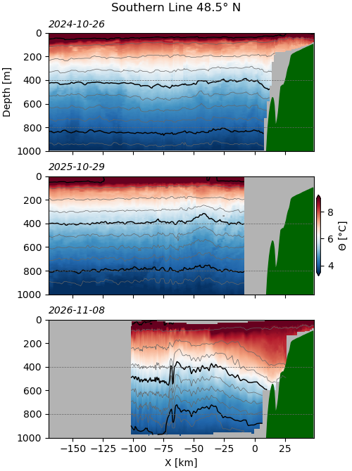
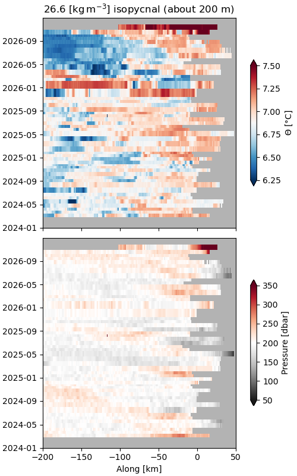

C-PROOF is seeing the first signs of El Nino in our underwater autonomous glider observations along the British Columbia coast, with temperatures as deep as 1000 m exceeding normal values.

[El Nino](https://en.wikipedia.org/wiki/El_Niño–Southern_Oscillation) is caused by a release of warm water in the western equatorial Pacific.  This warm water propagates along the equator to the west coast of the Americas, where it splits in two and heads both north and south as [coastally trapped waves](https://www.dillonamaya.com/home/ctw) (often termed "Kelvin waves").  These waves carry high sea level anomalies, and also can push warm water north along the BC coast.

[Satellite observations and numerical predictions](https://data.marine.copernicus.eu/product/GLOBAL_MULTIYEAR_PHY_001_030/description) indicate that the start of El Nino was about 30 October on the BC coast.  The animation below is from GLORYS-12 a model that uses observations to predict the ocean in realtime.  You can clearly see the propagation of high water starting around 30 Oct, and moving north.  The sea-surface temperature at 200 m also shows water being pushed north along the wave.

<video controls width="800">
  <source src="/img/2026/ElNino26SSHT200.mp4" type="video/mp4">
  <source src="/img/2026/ElNino26SSHT200.mov" type="video/quicktime">
  Your browser does not support this video.
</video>

## Seeing the El Nino with underwater robots

C-PROOF underwater gliders have been observing these changes underwater, a crucial way to verify the model predictions, and to better understand the structure of the El Nino under water.  Data from our Southern Line show the very large changes.  The Aug and Sep data are relatively benign.  We can start to see evidence of the El Nino in the October 17 data, with surfaces of constant density (the contours) being pushed down almost 100 m.  This is the underwater response to the sea-level rising at the coast.  The next glider occupation (Nov 8) shows an even stronger response, with constant density being pushed down almost 200 m and warm water extending up the continental slope.

Data from our Calvert Line also are perhaps showing the start if El Nino, with the constant density surfaces dipping down in the October 23 pass.  The glider `dfo-maria997` is on its way back to shore now and we are eagerly following what it sees over the next few days; [track Maria here](https://cproof.uvic.ca/gliderdata/deployments/dfo-maria997/dfo-maria997-20261016/).

## Is this really anomalous?

Of course a skeptical reader should ask if this data is really that anomalous?  Note this is also the time of year that we expect winds to shift and for the coast to see coastal downwelling, a phenomenon that also raises sea level at the coast and pushes constant density surfaces downwards.  So we need to consider whether what we are seeing is just the normal seasonal response, or if it is indeed the signature of El Nino.

Indeed these are the largest changes we have seen in the Southern Line since we started in Feb 2024.  Looking at previous Octobers, we see that this response is particularly strong compared to previous years.

The water along a given constant density surface is also anomalously warm and salty, indicating that water has been brought from further south along the coast, consistent with the expected signature of an El Nino event.  We see this with what is called a "Hovmoller" diagram, which shows the evolution of temperature on the 200-m isopycnal over time.  We can see that the water on this density surface is over 1 degree warmer than normal and over 100 m deeper than normal (bottom plot).

## Conclusion and outlook

Some of this data is preliminary and subject to revision.  However, the broad patterns seem robust that there has been a significant warming and deepening of the constant density surfaces along the Southern Line, consistent with the expected signature of an El Nino event, and the beginning of such a phenomena seen further to the north on the Calvert Line.

What do we expect to happen going forward?  El Nino is a large disturbance and should last for a few of months.  The sea surface height anomaly at the equator is still quite high, and the wave takes about 2 months to reach the coast of British Columbia.  It will be interesting to see the changes as El Nino continues, and then what happens with it relaxes.  Its important to note that these changes are not just caused by the Kelvin wave, but will be accompanied by changes in winds and weather systems that will further perturb the ocean and coastal conditions.

## Links:

- [Dillon Amaya's Coastally Trapped Wave page](https://www.dillonamaya.com/home/ctw)
- [NOAA El Nino page](https://www.climate.gov/enso)
- [DFO El Nino page](https://www.canada.ca/en/environment-climate-change/services/weather-general-tools-resources/el-nino.html)

### C-PROOF and Ocean Gliders
- [About C-PROOF and our partners](https://cproof.uvic.ca/about.html)
- [What is an ocean glider?](https://cproof.uvic.ca/platforms/)
